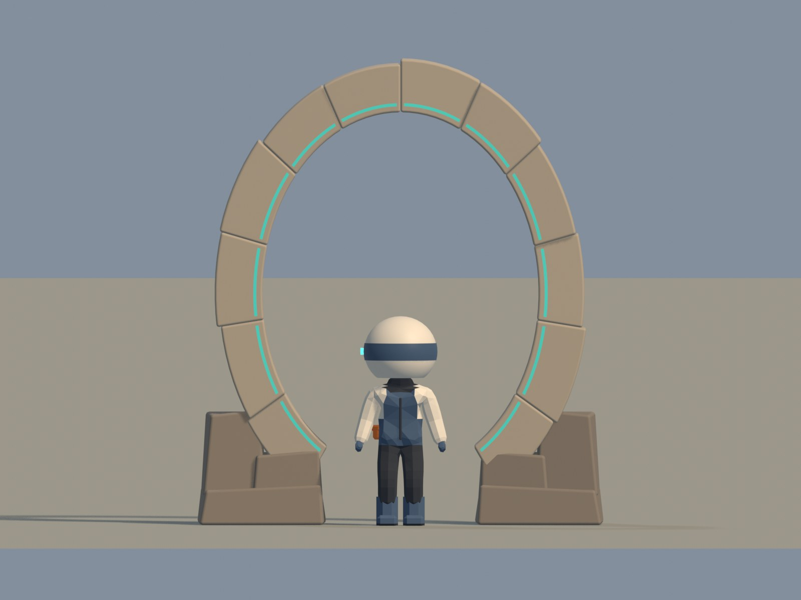
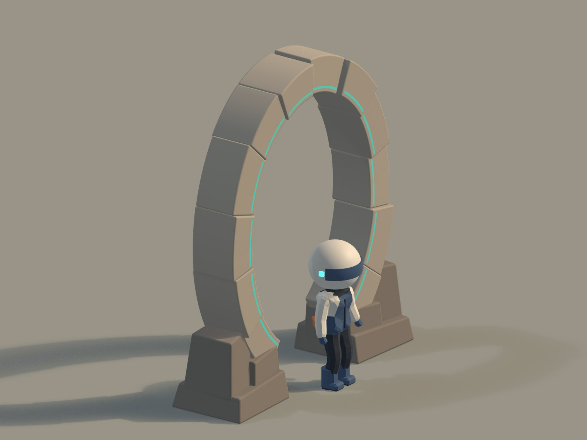
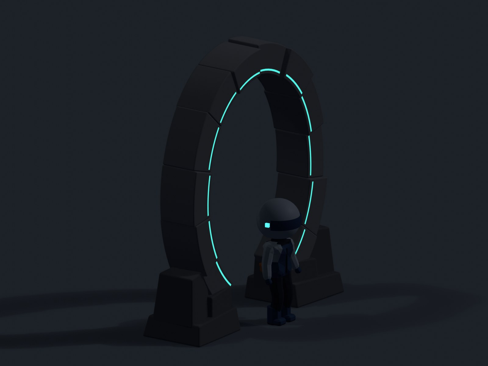

# G28 独立石环资产交付

2026-10-25：实际资产已完成 Phase 2 圆形修订，当前比例与运行对照见 [美术样板](../phase-2-art.md)，当前原生及 GLB 回读数据见 [qa-G28.json](qa-G28.json)。以下尺寸和制作环境属于初始版本的历史记录。

后续局部运行接入已在 [runtime/README.md](runtime/README.md) 单独记录。以下仍是资产制作阶段的原始证据范围，不能拿它替代运行报告。

本轮完成原清单 G28-A 的 L1 资产制作与 Asset QA。已先合入 `codex/world-integ` 的 `313685c`；只写 `park-integration`。未选 world 摆放位置、未接入 UI/trigger/collider、未修改主站页面或冻结文档。WorkBuddy global 审阅额度耗尽后入口语义没有答复，**不能将本次资产交付说成入口语义已审或已挂载**。

## 文件与接入接口

- `/assets/world/entry/G28.glb`：Draco 20-bit position / 12-bit normal。根节点 `G28`，米制、底面中心原点，GLB +Y 上、+X 前，环面 YZ；不要另加 90° 转轴补偿。
- 源：`tools/world/entry/build_portal.py`、`build_portal.blend`。Blender 4.2.23 LTS，+X 前、Z 上，导出器只做一次坐标转换。脚本 build / qa / render 三阶段可分别重跑。
- 分组 `G28_stones` 下 `G28_stone_01`…`12`；`G28_bases` 下 `G28_base_{L,R}_{foot,outer,toe}`；`G28_lights` 下 `G28_light_01`…`12`。所有部件原点保持根坐标原点，无非均匀缩放。12 主石与每侧 3 底石满足参考限制。
- GLB 世界包围盒：X **[-0.4650081, 0.4650076]**、Y **[0, 3.7791615]**、Z **[-1.6466405, 1.6466405]** m，即宽 **3.293281m**、深 **0.930016m**、高 **3.779161m**。原生 XY 中点与最小 Z 为 0。根 extras 中 `dimensionsMetres` 沿用作者的 Blender XYZ（深/宽/高），runtime 应以 GLB Box3 或上述 GLB XYZ 为准。
- 材质仅三种：`G28_stone`（stone，`#B4A896`，roughness .92）、`G28_stone_base`（stone，`#8C8276`，.94）、`G28_light_cyan`（light，`#4FD1C5`，.75）；metallic 均为 0。色板先转线性，无贴图、灯对象、相机、骨骼或动画导出。
- 内缘青线宽 **25mm**，仅石截面最薄约 .354m 的 **7.1%**，低于 1/5。每段埋入前切面约 11.5mm，外露约 .5mm；端部短断点沿石块接缝。只前面有青线，背面保留纯石材。
- 昼夜调材建议：运行时将材质 `emissive` 设为原科技青（three `set('#4FD1C5')`），`emissiveIntensity = .12 + 1.08 * night.value`。GLB 默认已将 .12 乘入 emissiveFactor，不能在这个已衰减颜色上再次乘 .12；或者保持 GLB 颜色，Intensity 用 1→10。两种方法只选一种。不新增光源。
- 原始 GLB **30 mesh / 3 materials / 4,392 triangles**；直接遍历绘制会有 30 次主 pass 提交，未来静态接入应按这三种材质合批，同时保留原节点用于同源碰撞派生。本轮无 world draw-call 或峰值预算实测、无 LOD runtime。

## 实测通过

详见 [qa-G28.json](qa-G28.json)。原生修改器后、重开 BLEND、独立 Blender 进程全新导入最终 Draco GLB 均为 **4,392 三角**：主石 3,024、底石 648、青线 720；低于建模前 5–8k 起点，未为数字堆面。新建资产没有可比的旧 GLB 三角基线，倍率不适用。

- 包围盒往返最大差 **0.000000477m**，材料库存一致、有效面积均非零；原生和导出 PBR 基色、粗糙度、金属度一致。导入器将 emission strength 合入 emission color，比较有效 RGB 后最大误差 **1.71e-9**。
- native 原始拓扑：0 非流形边、0 退化三角、0 负体积壳、0 反向绕边、0 非有限坐标、0 坏法线、copy Mesh.validate 不需修复。最终导入的 raw 拓扑保留 **1,156 条 normal-seam boundary**，并未改记为 0；同一物件 disposable 10µm 诊断焊接后，每件闭壳均无非流形/绕序/负壳问题。没有跨石块焊接，没有把刻意接缝消掉。
- 门洞：在 X=-.25/0/.25 三个深度、脚底以上 .03–1.731m 的 84 个高度采样，最窄横向净宽 **1.220247m**；中心附近向上净高 **3.343411m**。对 1.7m 高、.60m 宽角色有余量；这是几何净空检查，未代替 runtime 通过动作。
- 14 对石环/底石、底石/底石接合检出 BVH 三角交叠，属于承托嵌接；12 块主石径向端面相贴，倒角显缝，装配闭壳不声称整体焊接。168 个光条正面三角形重心向后射线全部命中对应石面，外露区间 **.4996–.5004mm**，没有悬浮面或共面 z-fighting。
- GLB 无灯源/相机/预览人物、无多余 presentation 节点。`astro check`：0 errors、0 warnings、134 hints。仅资产检查，没有重跑六展品或全岛路线。

## 看图判断

从最终 GLB fresh import 生成 **1600×1200** 的正面、前 3/4、后面、侧面、顶面、近景六视图，另有相同机位的夜档和中性 clay，均已实际打开看过。人物为现有 G24 的静态求值 mesh，归一化为 1.7m、脚底 Z=0，仅供 studio 尺度比较，未写进 GLB。

圆拱剪影连续，宽厚关系可读；真实倒角、端面接缝、少量切石面倾斜和底石锥度减少过于规整的塑料观感。没有孔洞、裂纹、苔藓、符文或任意面色噪声。黄昏线条克制，夜档亮度集中于细线，没有霓虹面、泛光或新增灯。





[后面](preview/G28-rear.jpg) · [侧面](preview/G28-side.jpg) · [顶面](preview/G28-top.jpg) · [近景](preview/G28-near.jpg) · [中性 clay](preview/G28-clay.jpg)

## 未验证与口味自检

仅 Asset QA，不是普通入口运行验收或 Bobby 接受。入口语义、摆放、触发行为、碰撞软硬决策、近远分级和最终画面预算由主线程后续接入；此处没有替它们做结论。未来若接石材实体，归为坚硬 fixed 并从 stone 网格同源派生，不能用覆盖整个门洞的一个盒子；触发语义另定。BVH 接合与采样射线不构成全局无自交的数学证明。

按 TASTE 第8节：①普通入口/默认镜头无挂载，本轮不适用；②六视图无灰盒原件、圆弧无显眼低边数；③与 G24 同画面对标，使用真实倒角/切石面，非随机细碎纹理；④黄昏/夜档 studio 均已看；⑤本轮不创建物理体，人与车撞击未验证；⑥静态石材，无新增动画，暂停行为未验证；⑦遮挡与镜头未接入；⑧4,392 三角/50.5KB GLB、原始30mesh，整岛预算未验证；⑨最可能批评是“太像规整瓷砖，少了石头的重量”，已用外缘轻微不规则、各石切面倾角、宽厚底石和哑光材质处理，不增加纹理孔洞或堆面；⑩机器、看图、运行与用户接受分别记录。

原始 PNG、GLB 哈希/视图 manifest、Blender 日志及 astro 日志位于仓库外 `/Users/bobby/Desktop/3D-personal-world/evidence/entry-G28/`。仓库仅小 JPEG 与 <1MB JSON。无推送或部署。

复现（在项目根目录调用）：

```sh
tools/blender-run.sh park-integration tools/world/entry/build_portal.py
tools/blender-run.sh park-integration tools/world/entry/build_portal.py qa
tools/blender-run.sh park-integration tools/world/entry/build_portal.py render
```
