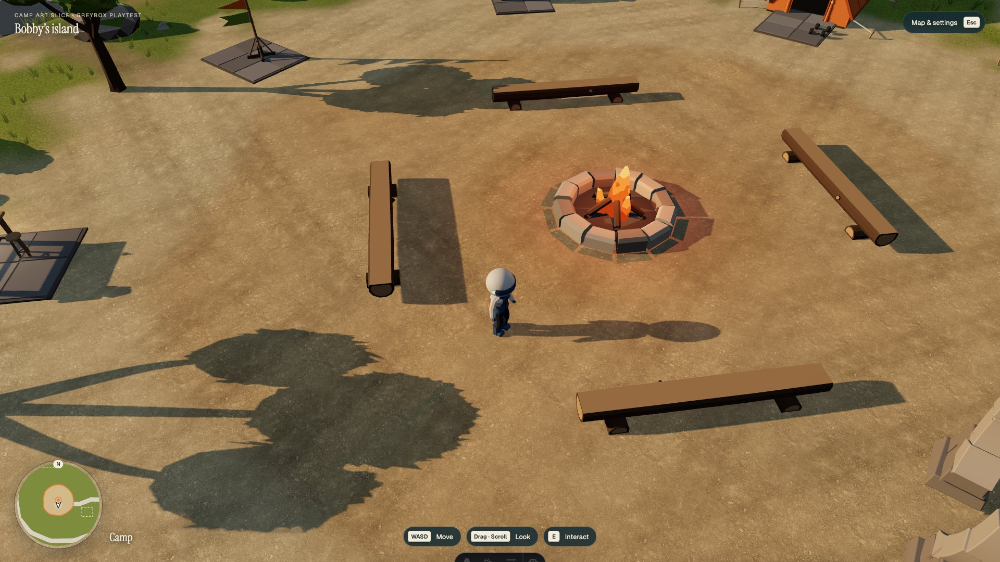
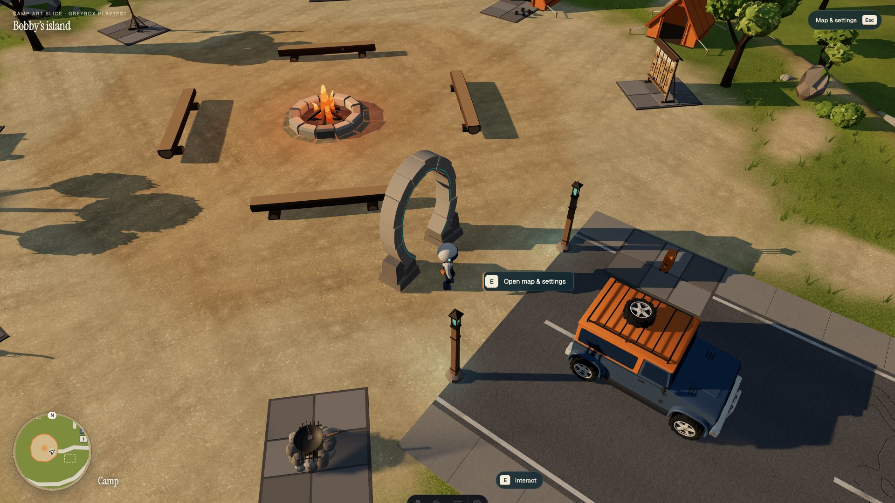
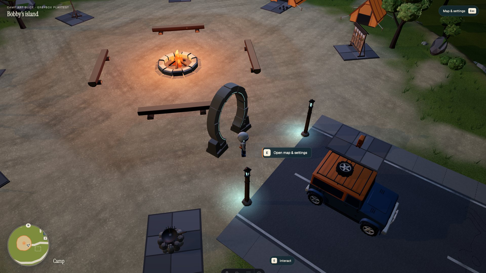

# G28 local world integration

Only WorldEntry, its WorldRuntime mount and two UI strings change runtime behavior. The original asset remains unchanged. PRD v1.13 / quality-v3 §15 authorizes current inventory production and interaction completion; this implements the existing menu locally. This is Codex's independent specification interpretation, not a new WorkBuddy ruling or frozen-document update. WorkBuddy's global allowance prevented its latest review response.

## Behavior and placement

G28 is at (-33.5, 4.8, 34), derived from existing EXIT_POSTS: 3.5 m west of their midpoint. It sits on the camp walking approach; eastmost asset bound is x=-33.035, while the road starts at x=-30. Existing layout, road, lamps, vehicle and neighboring camp props stay unchanged.

The inventory's explicit G28 non-blocking entrance-trigger exception is retained: no collider, no teleport, no physical stone-obstacle claim. The portal's walk-through test does not establish stone solidity. E says “Open map & settings / 打开地图与设置” and only sets paused=true, which is the actual existing WorldApp dialog API (there is no setMenu function). The existing menu still owns the separate portfolio link. Input, actors, store and other pages were not edited. Card, seat, driving, paused and shot states disable the registration; the existing controller owns state priority.

## Measured checks

`interaction.json`: real key walk from a logged west fixture through the opening reached the east target. E opened the existing modal; the URL stayed /world; another E did not dismiss it; Esc resumed. With valid `about/identity` card and seat state fixtures, real E closed the card / stood up without opening the menu. Zero G28 colliders and zero QA-page errors. The first invalid C07 card fixture auto-closed by existing UI and was corrected before final results; it was not a product failure.

Ordinary screenshots have no QA query or state fixtures: 1920×1080, initial camera, then real S/D walking and mouse zoom, then existing menu Night switch. Default, near and night images were personally viewed. G28 sits beyond the bench, inside the two exit lamps and outside the road; its opening, stone joints and restrained cyan line are readable. It does not visually overlap the road. Night uses the existing shared night blend and .12→1.2 emission; no added lights.

`astro check`: 0 errors, 0 warnings, 135 hints. Vite 504 after concurrent dependency optimization was resolved by restarting this worktree's service with --force. A normal-page 404 was logged (not a runtime page exception); QA-page errors are empty. No full-island test rerun.

## Cost / LOD

Original 30 nodes / 3 materials / 4,392 triangles become 3 main-pass submissions. Every geometry and transform is preserved at <60 m. At ≥60 m, 30 per-node boxes retain the segmented outline/open centre at 360 triangles (8.20%); at ≥140 m both visual groups hide. Far/cull switches were observed from logged camera-distance fixtures. Those fixtures do not prove a continuous LOD-transition art review. No low-detail colliders or additional lights are made. Low meshes never cast shadows, avoiding duplicate static shadow baking of both LOD groups. Only the two high-detail stone batches cast; the cyan batch does not. The existing shadow system merges static casters, so per-object main-pass rows do not isolate G28's shadow cost.

Measured local totals (all passes): dusk 172 calls / 460,794 triangles, night 173 calls / 461,522 triangles. These views stay within 300 / 500k; this is not a whole-island peak pass. Shadow subtotal is 200,174 triangles in these views, above the current 110k planning allocation; this pre-existing integration allocation issue is not closed by the total being below 500k.

Cost belongs to camp via budgetZone. `cost.json` contains actual complete-frame multi-pass counters for this one local view in dusk/night and G28 main-pass rows. The 3 calls / 4,392 triangles hide difference in interaction.json is only the main-visual delta: hiding the original group does not remove already-baked static shadow chunks. Do not call it total G28 cost or full-island peak. All shadow submissions remain included in the cost.json whole-frame totals.

## TASTE self-check and limits

1. Ordinary default, near and night 1080 images viewed (below).
2. G28 is the finished GLB, not a near-view box; original micro-bevels remain. Other scene art is outside this change.
3. Stone geometry, scale and joints remain the reviewed asset; matches adjacent camp scale.
4. Dusk and night viewed; no extra illumination source.
5. G28 is the explicit non-blocking trigger exception. Human doorway traversal passed; no new collision was added. Vehicle-through-ring test was not run (a car is wider than its pedestrian opening); no vehicle or stone-impact acceptance claimed.
6. Static stone stays static; shared night transition used. No new animation clock.
7. Meshes opt into existing occlusion fade. A dedicated camera-penetration/occlusion orbit test remains unperformed.
8. Main-pass and same-view total multi-pass costs recorded; global peak/first-load budget and M1 remain unverified.
9. Likely criticism: “A stone gate should block me when I hit its side.” This version intentionally retains the explicitly requested non-blocking G28 semantics; do not present that exception as realistic stone physics. A later solid-stone change would require the main thread to choose a different semantic implementation.
10. Machine results, visual judgment and Bobby acceptance are separate. Bobby has not accepted this integration.

Raw and complete report files: /Users/bobby/Desktop/3D-personal-world/evidence/entry-G28/runtime/. Reproduce with bot-run.sh park-integration 4341 tools/world/entry/playtest.mjs or tools/world/entry/cost.mjs. No main push, merge to delivery branch or deployment.
