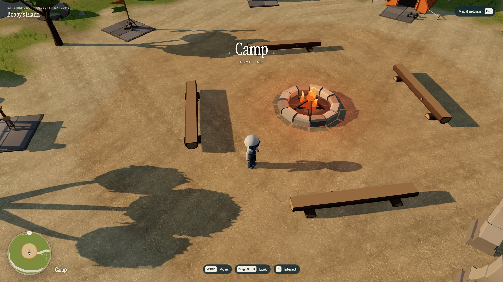

# 整岛动作追加修复与停点

## Status

运行时代码基线 `e2db366`，追加在已发布 `2852612` 之后。停步脚底贴坡及转身退出分类修复已接入，**完整动作门仍未通过**。真实起步和连续地面支撑两个下一层方案已具体化，但没有获冻结文档所有者裁决。2026-10-25主线通过备用Claude-Opus-5.5实际发送请求，消息已入会话，约11秒后以未知错误结束，无裁决；界面另显示全局额度用尽，具体后台原因未确认。此前仅凭空输入框禁用判断“无法发送”的描述已纠正，不能把请求送达当作获批。新账号接手入口见 [CONTINUE](../CONTINUE.md)。

## Result

- Stop 的目标使用当前静态支持面及实际旋转靴底反算高度，避免覆盖先执行的 Slope 脚掌姿态；两项仍共用 5 cm 骨盆预算，腿不拉长。
- 转身/待机小动作退出到跑步时使用 gait 惯性衰减和既有支撑筛选。保留完整原始 sole 记录，不再丢掉高度超过 10 cm 的点。
- 同步采集 body、速度、实际胶囊 cast、接触与最终 sole，确认坡顶部分帧胶囊离实际支撑约 176 mm，旧射线仍标着地。`.82` 是正确的视觉脚根偏移；`.88` 是出生安全间隙，未以改视觉根高度掩盖浮空。
- 两个受限切向速度实验不足以关闭浮空，已全部撤回。真正的 StartRun 先做 FK、作者裁剪区间核对和正常速度预览；不合许可倍率/时间或腿可达限制的候选没有挂载。
- 所有生产 GLB、原 G24/15 段 Action、资产清单及原接触曲线保持原字节/内容，`git diff 2852612 HEAD -- public/assets/world docs/world/assets-v1.json docs/world/资产清单-v1.md` 为空；未重跑全岛库存。

## Verification

| 本轮实测 | 结果与限制 |
| --- | --- |
| 最新 Astro / build | 254 文件，0 errors / 0 warnings；生产构建成功。日志在外部 evidence/integ/ |
| 原完整 motion-bot | 1178 帧，0 pageerror；Idle→Run 183.8 mm、Land→Idle 105.5 mm，**动作未通过**。Run 汇总桶混有过渡，不能当作稳定 Run 或直接判新回归 |
| 原坡路线 | headline 415 站立相样本：87 浮空、0 下陷；另列非 Stop-swing 299 样本：6 浮空、0 下陷，最大浮空161.5 mm。阈值仍20/15 mm |
| 最终组合 A6 | 所有完整 Stop block及邻帧、每个 Run/Sprint 站立相失败前后100 ms，共202帧；sampleStride=1，完整同壳/跨壳关系表，全部通过。仅覆盖这些受影响帧 |
| 限幅 | 骨盆50 mm、单脚100 mm、pitch/roll各20°，没有扩大 |
| 热路径冒烟 | 本地同机位5 s顺序A/B：59.0→58.8 fps，p95 16.7→16.8 ms，均1920×1080。构建曾同时启动，可能影响首样本，只作参考；不是M1 Air或全场景认证 |

机器摘要：[summary.json](motion-followup/summary.json)。全部原始帧、skin、202帧窗口与A6在 `/Users/bobby/Desktop/3D-personal-world/evidence/integ/motion-followup/`。未重跑既有21项驾驶、80项清单、全岛巡游或预算矩阵；原结果继续归属于各自原版本，不改写成这轮重新通过。

已亲看本轮普通入口的黄昏默认/近景和夜间近景，未见补丁新增静态造型问题。默认图如下；大于400 KB的原始近景图保留仓库外，路径列于摘要。静态截图不替代连续动作、美术或 Bobby 接受。

## Handoff

1. [真实起步方案与几何冲突](../character/start-run-review.md)：CMU 正常相似时间下首支撑仍无法匹配当前加速。需裁决受控时序重定向或协调加速曲线；没有为通过指标缩短完整起步窗口、修改旧接触曲线或提前挂载候选。
2. [连续地面支撑待审方案](../character/slope-followup/review-request.md)：在 dynamic 胶囊内用连续 cast 约束竖直地面跟随，保留跳跃、水平操控及碰撞。两个更小的速度方案均已实测并撤回；尚未获新控制器层许可。
3. 原整岛美术残留、G27理想轮胎2.11 cm、完整10/20/25°坡矩阵、M1 Air、Safari、实物手柄与 Bobby 接受仍保留。没有任何「待 Fable 补图」的新资产。

仍不推 main、不合并 PR、不手动部署、不用 Hy3D。Bobby 最可能指出的仍是“起步滑、坡上浮空”；这轮修复一类下陷并找到剩余问题的实际层级，没有把它们包装成已完成。
