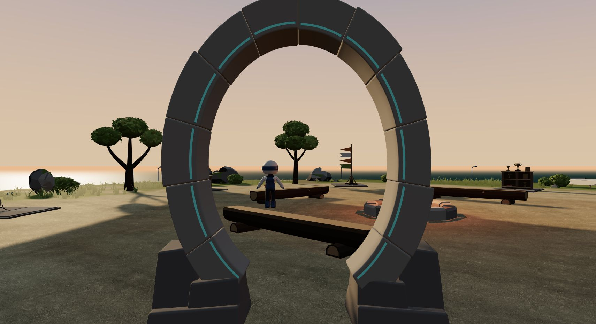
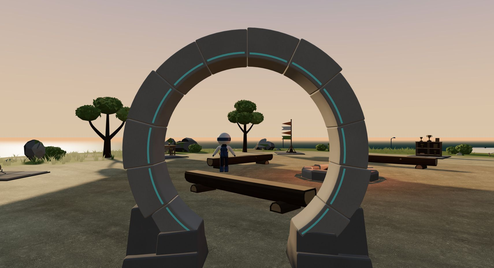
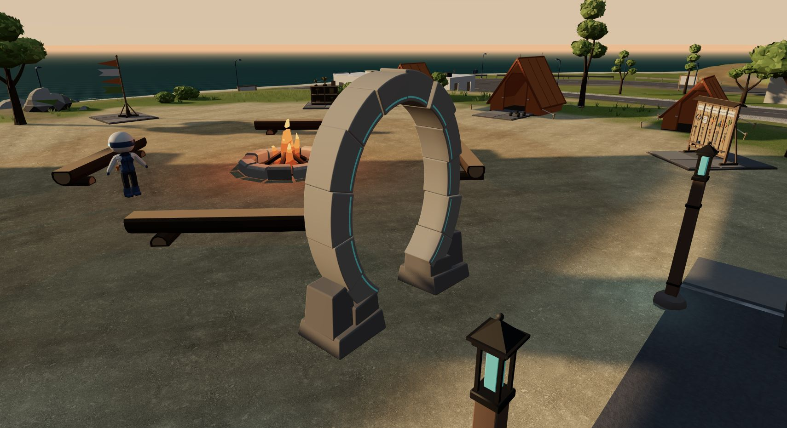
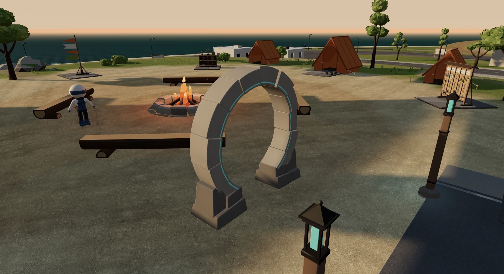
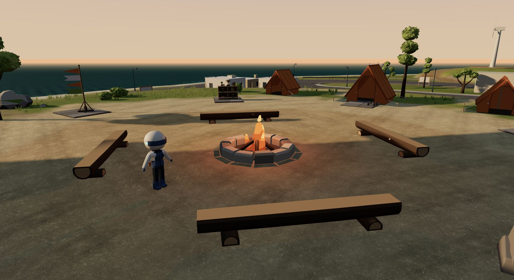
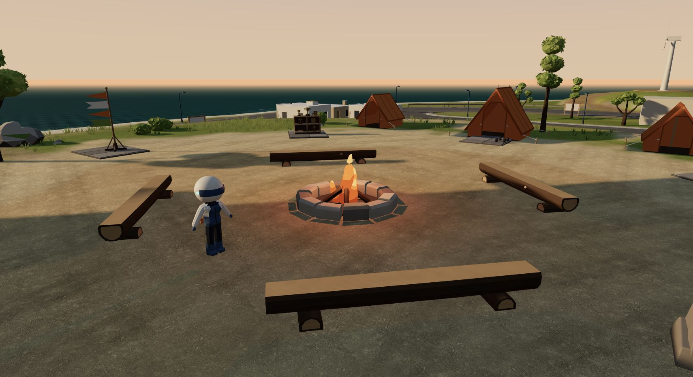

# Phase 2 美术样板

本轮基线：`3cb1f25`。本地美术分支上的可试玩改进，未推送、合并或部署；人物动作、车辆动力学及驾驶 HUD 由其他工作线负责。

## 造型与表现

- 石门原始外圈水平／垂直半径为 1.50／1.88 m，内圈为 1.12／1.47 m。实例没有额外非等比缩放，纵向拉长来自源模型。
- 新外圈半径均为 1.65 m，内圈均为 1.25 m，圆心高 1.65 m。保留十二段石块、底座、前侧青色嵌条与米制坐标，不改镜头透视来补偿造型。
- 当前 GLB 整体宽 3.310419 m、高 3.319319 m、深 0.930016 m。石块细微起伏和底座使包围盒不必精确为正方形，内弧的圆形应由实际径向检查判断。
- 石门、火塘石面增加轻微风化与脚部色差；营地长凳增加沿本地 Z 轴的木纹和端面年轮。细纹按像素覆盖范围淡出，复用实例化和现有绘制批次，不新增贴图。
- 稍抬现有半球填光，让背光石面与木件保留层次。没有增加灯、后处理或阴影贴图。
- 石门青线在可交互距离内略增强。提示增加双语地标名，提升背景稳定性与文字对比度，约束右侧最大宽度，并补全减少动态效果设置下的按键动画关闭。
- 修复设置右栏的 Grid 最小高度，让展开操作说明后的长内容可以在弹窗内滚动；驾驶文案保持由驾驶线维护。

## 复现

正常入口：`/world/`。走到营地石门旁，按 E 打开地图与设置；Esc 返回。昼夜、语言、画质沿用原有菜单。

QA 对照固定机位：

| 地址参数 | 用途 |
| --- | --- |
| `?qa=1&artview=portal-front` | 正视近景，观察圆弧比例 |
| `?qa=1&artview=portal-angle` | 同机位斜视，保留正常透视 |
| `?qa=1&artview=camp-detail` | 营地材质与填光 |
| `?qa=1&artview=walk` | 正常步行镜头与只读诊断 |

固定机位会冻结物理，不构成从出生点步行到达的证据；画面里的角色姿势不用于人物动作验收。加 `shot=camp-night` 可复查夜间表现。`data-art-probe` 仅在以上 QA 模式输出入口挂载、装载状态、渲染成本与最近 120 帧时间，供机器负载下的局部排查，不能当成正式性能认证。截图前应等入口及场景资源挂载完成。

## 画面对照

以下为实际运行画面，没有使用概念图或历史验收录像。

| 基线 | 改进 |
| --- | --- |
|  |  |
|  |  |
|  |  |

正视近景的旧版门顶略超出画面，新版使用相同机位与 50° FOV。斜视投影仍然呈椭圆，这是正常透视，不再通过模型拉伸补偿。

补充画面：[夜景](phase-2-art-evidence/after-portal-night.png)、[中文石门提示](phase-2-art-evidence/stone-gate-prompt-zh.png)、[1024 px 英文提示](phase-2-art-evidence/stone-gate-prompt-en-1024.png)、[1280×680 右栏底部](phase-2-art-evidence/menu-scroll-1280x680.png)、[1024×680 单列底部](phase-2-art-evidence/menu-scroll-1024x680.png)、[390 px 手机入口](phase-2-art-evidence/mobile-entry-390.png)、[无 QA 参数的普通入口步行](phase-2-art-evidence/ordinary-entry-stone-gate.png)。

## 验证与边界

- 使用本机 Blender 5.1.2，`--background --factory-startup --disable-autoexec --threads 2`，顺序执行源脚本的 build 与 qa。普通启动曾卡于 macOS 共享文件列表初始化；隔离启动恢复，没有安装软件或修改用户设置。
- 原生、保存后重开、独立导入 GLB 的拓扑检查通过。模型仍为 4,392 个三角面、三种材质，文件 51,100 字节；源 BLEND 与 GLB 一同更新。
- 独立 GLB 回读的十二段石块内弧半径范围为 1.249520 至 1.249569 m，差约 0.049 mm；所有节点缩放为 1。三角面和材质名一致，边界误差为 0.000000477 m，无额外灯或相机。完整数据见 [模型 QA](entry/qa-G28.json)。
- `npm run check`：256 个文件，0 errors、0 warnings、135 hints。`npm run build`：通过，生成主页与 world 两个页面。
- 在真实 Chrome 场景中读取并检查了以上画面。正视、斜视、昼夜均加载新 GLB，运行时半径元数据为 1.65／1.25 m，实例缩放为 `[1,1,1]`；近景 4,392 三角面、远景包络 360 三角面、三种批次材质保持不变。
- 从出生点使用实际 S／D 按键步行到石门，出现中英文地标名和交互提示；E 打开地图，Esc 返回。无 QA 参数的 `/world/` 再次完成同一路线、E 与 Esc 验证，普通页面没有 QA 探针。没有用瞬移完成这段路线。
- 1280×680 展开 Controls，右栏 clientHeight 624 px、scrollHeight 915 px，实际滚动到 scrollTop 291 px，底部驾驶说明与返回按钮可见。1024×680 单列模式由整个弹窗滚动：clientHeight 624 px、scrollHeight 1387 px，滚动到 763.5 px，底部可达。单独设置右栏 `min-height:0` 不够，桌面行轨道还须为 `minmax(0,1fr)`；窄窗口恢复自动行轨道。
- 390×844 保留原有的桌面体验提示，文字与返回链接可见；没有增加手机 3D 控制。
- 暖机后的局部 QA 样本：1024×680、Balanced、石门旁驻足，最近 120 帧 p50 16.6 ms、p95 23.8 ms。冷加载及画质切换样本波动明显，未做同负载版本间性能对比，不能由此宣称全岛帧率或性能提升。原始局部数据见 [runtime-samples.json](phase-2-art-evidence/runtime-samples.json)。
- 本轮读取的浏览器 JS／材质编译错误日志为空。普通入口的本地统计请求 `POST /api/events` 在静态开发服务中返回 404，本轮没有修改或验证统计端点。
- 4344 服务与自有渲染标签页已关闭，视口已恢复，共享重型锁已释放；只保留小量截图、原生源与 QA 数据。

## 后续与交接触点

- 保留：现有海岸世界的色彩、低多边形轮廓、青色细线与暖色营地。
- 已修复：源模型圆形比例、石木表面层次、背光填充、交互文字层级与菜单裁切。场景材质没有新增贴图、灯或后处理。
- 后续可细化：近景石材与木件的触感、夜间基座接触感，以及与人物／驾驶新版本合流后的连续路线。视觉和操控感仍需用户实际体验；本轮不是全岛性能或全动作验收。

共享触点为 `WorldCamp.tsx`（C05／C06 材质及 QA 相机）、`WorldEnvironment.tsx`（现有半球填光）、`WorldEntry.tsx`（石门材质和青线反馈）、`WorldCards.tsx`／`world.css`（普通交互提示、菜单滚动）、`world-i18n.ts`（仅新增双语石门名）。驾驶说明和速度表没有修改。石门继续沿用原有非阻挡地图入口语义，未新增传送或硬碰撞。
