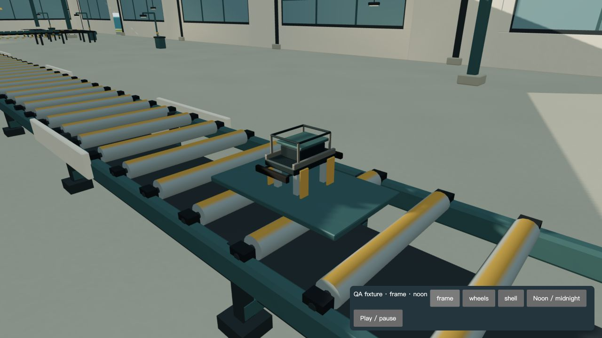
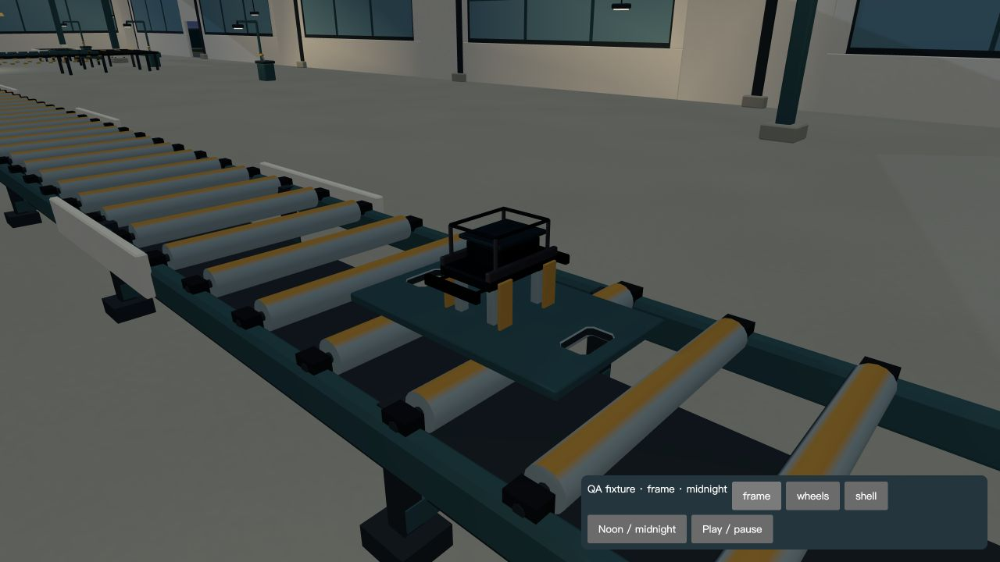

# 工厂运输托盘精修，2026-10-30

已实施一个有限但真实的近景模型改进。当前活动版本为 `/Users/a22309/Desktop/Side-projects/Artifacts/personal-world-phase2-integration`，分支 `codex/world-alpha-pilot`，HEAD `f248bc235e7a66ec3a112207f17b79ce44bff8b2` 加现有未提交候选。旧 `personal-world-bruno` 不是本轮入口。4343 为本地候选，4341、公开网站和远端没有更新。

原统筹会话 `10-3D-interactive-builder` 已确认其它实施者停写，并把 `factory-carrier.ts`、`factory-carrier.test.mjs` 留给本任务独占。两文件原本就是未跟踪候选，已保存逐字原件；没有把它们误当作本轮从零创建的全部成果。附带补丁仅包含本轮相对原件的增量。

实际问题：托盘是一块无开口的厚度 6 cm 实心薄板，近景缺少用途明确的结构细节。工厂实景另有大面积空地、设备层级偏薄等问题，它们不在这两份文件的独占范围内，仍交原统筹推进。用户尚未认可整场景美术。

本轮将三类运输底板改为带两个真实贯穿手孔的闭合网格，180×300 mm 清孔，25 mm 切角和 8 mm 入口倒角；孔缘使用已有银色金属，内壁使用已有钢材。上下表面围绕孔口重新三角化，不叠黑色贴片、不保留封孔实体面。保留三类部件的定位块、真实支承面、平底滚轮接触范围、外廓、原点和全部运动坐标。代码仍为可编辑的程序建模源，无新增外部模型、贴图、材质、光源、网络请求或软件依赖。

| 模块 | 原三角形 | 新三角形 | 原属性及索引字节 | 新字节 |
| --- | ---: | ---: | ---: | ---: |
| frame | 444 | 596 | 62928 | 85632 |
| wheels | 396 | 548 | 56592 | 79296 |
| shell | 356 | 508 | 50352 | 73056 |

每个增加 152 三角形、22704 字节；三者共增加 456 三角形、68112 字节。每个仍为单批几何，材质由原调用者共享；这是属性和索引的字节统计，不是总 GPU 或浏览器内存。保留原有 <2500 面断言，新增更严格 <800 面检查。

验证结果：

- 29/29 定向测试通过，0 skipped，日志 `targeted-tests.log`。包含真实孔口双向贯穿射线、金属倒角的实际顶点属性、闭合边及重复三角形、两种配置的真实部件支承、轮组完整旋转、全运输相位至少两滚轮接触、压机及吊运全行程几何净空、返工与暂停语义。
- `factory-carrier.ts` 完整依赖的严格 TypeScript 检查 exit 0：`node_modules/.bin/tsc --noEmit --strict --skipLibCheck --target ES2022 --module ESNext --moduleResolution Bundler --jsx react-jsx --allowImportingTsExtensions --resolveJsonModule --types vite/client src/components/world/factory/factory-carrier.ts`。
- `npm run build` exit 0，10.69 秒，两页构建；日志 `build.log`。临时验收页已在构建前移出 `src/pages`，未加入产品页面。构建仍有混合静态/动态 layout 导入及 >500 kB chunk 警告，此轮未处理。
- `git diff --check` 通过；此命令不涵盖未跟踪文件，新增文件另以定向测试和 TypeScript 检查验证。
- 实际 IAB 浏览器复用一个标签，1280×720 CSS、DPR 2、2560×1440 drawing buffer，balanced、晴天、固定 FOV 50。原始 JPEG 1280×720，未 AI 美化。正午前后为同一固定机位；午夜只有修订后证据，不声称有完整午夜前后比较。
- 正午亲自检查三类托盘；午夜亲自检查 frame/shell，孔壁和滚轮可读。未做像素级配准、实机 FPS 或内存收益声称。此轮是固定展示样本，不冒充玩家完整制造/返工试玩；连续运动和接触来自上述几何/动作回归。
- 390×844 浏览器检查显示现有窄屏提示和返回个人站链接，无 3D 驾驶或导览。未改这一既有产品限制，未做真实手机或 Safari 验收。
- 验收页初版时间函数导入错误已修正并重载；后续未观察到新 shader/model 运行错误。Three Clock 与 Rapier 初始化弃用提示仍存在，不据此宣称全项目控制台无告警。

截图：

复查：`review-fixture.astro` 是暂存的本地 QA 页面；复制回 `src/pages/world-carrier-review.astro` 后，用 4343 打开 `/world-carrier-review/?qa=1&quality=balanced`。待场景 ready，点 frame/wheels/shell 切固定视角；首次进入需再点一次，以免分区挂载时载入存档覆盖展示样本。Noon / midnight 切时间。它复用实际 World 页面、几何、材质、灯光及载具定位逻辑，注入只在内存的三类部件样本，没有写玩家存档，也没有把样本当成完成的玩法。截图中的 QA 面板属于验收工具。复查结束把该文件移回证据目录，避免进入产品构建。

回退：仅在两份文件仍由本轮独占且没有后续编辑时，使用附带两份 `.patch` 的 reverse apply，或恢复 `.before` 原件；不要覆盖未来协作者改动。`.after` 是当前候选快照。

边界：本轮没有重设计主场景、压机、Alpha 岛、音乐、驾驶或公共 UI；没有 push、PR、公开部署或修改 4341。技术检查通过，整体视觉与审美仍待用户验收。下一步高价值工作是工厂空间密度和主机轮廓、走动视角下的全场闪面巡检、以及主统筹已有的运行性能审查，而不是继续堆托盘微型零件。
