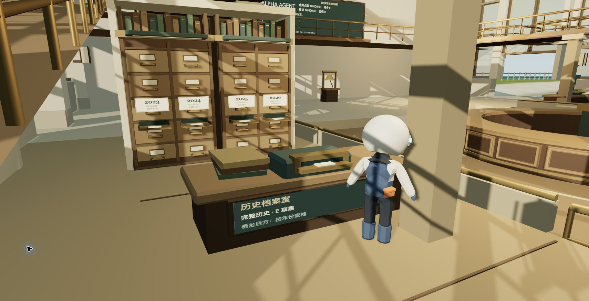
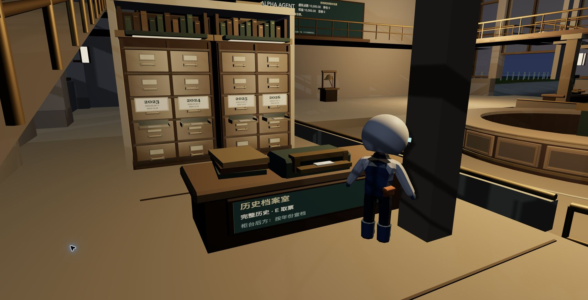

# v38：可取票的年度档案柜

## 本轮结果

Alpha 交易所的档案柜现在有实际用途。档案台读取线上历史后，玩家可领取完整历史票，也可绕过柜台，从后方四个托盘取出实际存在的年份票，再带到中央票槽开始重演。仍需真实手部接触才提交取票；插票后不能中途切换年份。

柜体沿用已批准的 [v2 参考](alpha-exchange/rebuild-v2-20261029/reference.json)，增加石框、木作凹边、顶部档案、实体铜托盘与局部暖光。原来挡住柜前的悬浮牌已移到柜台正面。没有增加实时灯、阴影光源或几何批次。

音乐继续保留用户已认可方向的 v36 母带与衔接方案，本轮没有替换音源，也不把方向认可视为最终听感验收。

## 数据与状态

- 目录来自通过既有校验的在线 SPY 基准，完整历史加最近最多四个不少于 20 个交易日的年份。部分年份按实际首尾日期标示，不伪装为全年。
- 每个子时段从 NAV 100 重基准化，保留真实日期。年份标签不提供涨跌提示或最终收益。
- 当前浏览器实际返回 752 个日期，范围 2023-05-02 至 2026-04-30；年度分别为 168、252、250、82 日。这是本轮响应证据，不是硬编码目录。
- 首次浏览器请求 25 秒超时，手动重试成功。独立请求也返回 HTTP 200，耗时约 1.36 秒。保留真实错误与玩家重试机制，没有启用替代行情或自动轮询。
- 每份精确日期／源 NAV 身份保存一份最近已清算回执，最多五份。换年不会混用比较结果，源数据变化也不会复用旧回执。取消未完成轮次不会覆盖已完成回执。
- QA 对照读口不再提前返回上轮终值，只返回本日对应记录及是否存在历史对照。

## 验证

58 个针对性测试通过，覆盖目录、重基准、来源身份、A→B→A 回执、陈旧回调、取消与重取、实际动作接触协议、会计计算、回顾、音效、几何与通行。严格 TypeScript 检查、音频资产检查及 Astro 构建通过。

浏览器使用一只已有 Chrome 标签，流畅档、1710×875 CSS 视口。四个年度票均通过真实动作提交，接触计数依次为 1、2、3、4。前三次换票使用开发定位控件触发既有取消／归还流程，不能把它们算作完整步行路线。

最后一张 2026 年票由角色实际带出柜区，沿柜台右侧与正面通道走到中央票槽并插入，没有用定位跳过这段路线。带票路线保持着地，角色从柜前约 `[49.46,2.41,-77.35]` 经右侧 `[50.82,2.41,-78.52]`、出口 `[50.82,2.41,-73.05]` 走到中央 `[58.62,1.96,-69.99]`。之后用开发定位控件缩短既有工作台、开市钟、清算室之间的路程，动作本身仍由 E 触发并等接触确认。

年度回放从 2026-01-02 依次推进至 02-11、03-23、04-30，持仓 10 份，清算权益为虚拟点数 10051.9490，回执包含三次选择，最终接触计数 13。这里验证计算和动作完整性，不是投资建议或实盘结果。最后上回廊的尝试随暂停取消，不列作本轮成功验收项。

完整运行证据：[runtime.json](qa-20261029/exchange-v38/runtime.json)。

## 视觉与性能边界

同一既有机位 `[46.1,3.8,-70]`，目标 `[48.3,2.6,-74.5]`，正午和深夜固定时间。已逐张查看，并对比 v34 与已批准参考。年份、票槽、木框和夜间局部补光可辨认；参考图的外围植栽、墙面层次与整体建筑丰富度仍未完全还原，不能据此宣称整座交易所完成美术验收。

静态 body 从 27792 增至 29508 三角，glass 保持 144，柜区共 2680；实体碰撞 19972，走面 120。另增加一张 512×256 标签图集和四张票据小网格，标签只在目录或语言变化时重绘，无新增轮询。新增外伸托盘使用可见几何对应的实体碰撞；四站位、手部路径、前侧通路、西侧坡道及右侧绕行均经过胶囊／射线检查。

局部带票走出柜区的 34.77 秒采样共 2083 帧，p50 16.7 ms、p95 17.9 ms、最大 45 ms，超过 25 ms 的帧占约 0.096%。该窗口没有场景工作或阴影重建。运行结束控制台错误为空。该数据仅覆盖本机、本视角和本段路线，不代表全地图或所有电脑的性能保证。

## 交付边界

本轮更新开发分支及本地试玩，不合并 main、不发布生产站。整体 goal 仍在进行：外围建模与照明、国投玩法拓展，以及音频最终听感仍需后续工作和用户体验反馈。

本地 4341 使用 `/tmp/bobby-world-v38-20261029` 的正式构建，HTML 已逐字节比对。候选正式构建无开发 QA 控件，启动后设置面板可见、加载层消失、控制台无错误。生产路径与候选 SHA 记录在 [production.json](qa-20261029/exchange-v38/production.json)。保留 v37 构建作回滚；临时 4343 服务在切换后停止。
