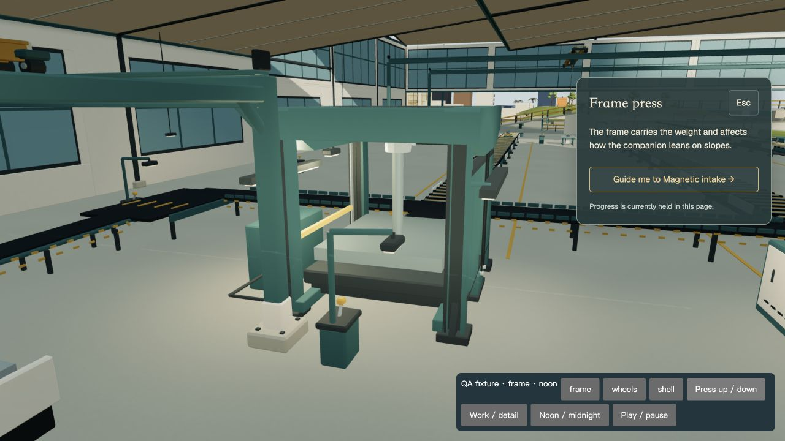
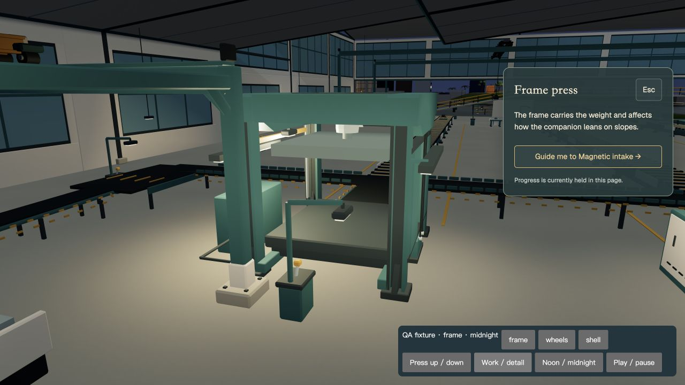

# 压机机架与活塞接合修复，2026-10-30

活动目录：`/Users/a22309/Desktop/Side-projects/Artifacts/personal-world-phase2-integration`。分支 `codex/world-alpha-pilot`，HEAD `f248bc235e7a66ec3a112207f17b79ce44bff8b2` 加既有未提交候选。服务 `http://127.0.0.1:4343/world/`；4341 和公网未更新。原统筹会话逐项确认本轮文件独占权；未修改其它协作者的段落、布局、灯光或游戏时序。原件与增量补丁保存在本目录。

本轮在托盘小批之后继续修复了更醒目的设备问题：

- 原立柱是三条平行箱体，之间各有约 60 mm 空隙。现在使用连续工字截面的封闭挤出网格，连接腹板与翼缘；原外廓、柱脚、上框接入位置、保守箱体碰撞范围保留。
- 上框两条矩形梁重组成带斜肩的深冠梁，使中央载荷经肩部回到四柱。保留三类机架原有差异、中心真实杆孔、压床、横向物料通道；新增中心垂片具有匹配碰撞体。柱间其它检修罩、轴承座与外壳围护没有删除。
- 液压硬管通过可见的实体六角接头接入油箱与固定套筒；管路起点从油箱顶部倒角附近移到实际可接入的后立面。没有新增装饰性运动机构。
- 实际最低行程发现旧活塞杆顶与套筒下口脱开：frame 0.875 m、wheels 0.775 m、shell 0.955 m。`WorldFactoryMechanisms.tsx` 仅新增杆引用、Y 姿态同步与 mesh 接线。新 `factory-press-rod.ts` 让可见杆顶恒留在套筒内的 Y=4.98 m，下端始终伸入压板 0.06 m；复用同一圆柱网格、几何和材质，仅更新局部 Y 的位置及长度，计算无对象分配。压头、护门、联锁和生产操作时钟未改。

| 机架 | 原三角形 | 新三角形 | 原属性及索引字节 | 新字节 | 原/新碰撞体 |
| --- | ---: | ---: | ---: | ---: | ---: |
| frame | 1636 | 1732 | 222672 | 237264 | 25 / 27 |
| wheels | 1812 | 1908 | 243504 | 258096 | 25 / 27 |
| shell | 1664 | 1760 | 225888 | 240480 | 22 / 24 |

静态厂区总预算 64,684 → 64,972 三角形，仍严格小于 65,000；静态碰撞体 888 → 894。三台机架共增加 288 三角形、43,776 属性/索引字节，无新增材质、贴图、灯、draw group 或 render pass。杆修复不增加几何。托盘属于动态模型，另计于上一包；这些 authored 数不是整场景实际绘制面数，也不是 GPU 总内存。

已验证：

- 最终 48/48 定向回归通过，0 skipped，10.50 秒，见 `targeted-tests.log`。七组：carrier、machine-casing、press-rod、geometry、production-detail、operation、return。包括实际部件/托盘和压机全通道、步行及相机净空、返工吊运、工字截面真正连接、冠梁及液压接头、三种坯料在 30/60/120 Hz 的完整下压回程、提前释放和暂停，逐样本检查实际 CylinderGeometry 世界端点与压板接触。
- 初版新增柱截面射线测试把同一处合法护门导轨/外罩也计入截面，产生一次失败；确认交叉来源后改在导轨与外罩上方的三段裸露柱截面测量，未放宽原有碰撞、全行程和面数断言。最终全部通过。
- 修改的四个运行入口及完整依赖严格 TypeScript 检查 exit 0：`tsc --noEmit --strict --skipLibCheck --target ES2022 --module ESNext --moduleResolution Bundler --jsx react-jsx --allowImportingTsExtensions --resolveJsonModule --types vite/client`，入口为 `factory-carrier.ts factory-machine-casing.ts factory-press-rod.ts WorldFactoryMechanisms.tsx`。日志 `typecheck.log` 为空表示无诊断。
- 最终 `npm run build` 结果见 `build.log`。临时 QA 页在构建前移入证据目录，产品只保留原有两个页面。混合静态/动态 layout 导入及大 chunk 警告尚未处理。
- 已核验工厂原批准的参考 manifest；此轮为既定方向的结构/动作修复，没有伪造新的用户审美批准。
- 真实 4343 页面内的固定工位及细节机位有原始日夜前后 JPEG；三台压机的最低位都亲自回看。`before-rod-lowered-day` 是已改机架、尚未改杆的中间基线，`after-rod-lowered-day` 只比较杆修复，避免混淆两批变化。不是独立模型棚拍或生成图。
- 冷加载后在实际正常工位视角运行了一次完整生产行程预览，页面显示 `QA cycle complete · no save writes`。预览复用真实 `stepFactoryOperation` 和生产渲染，但不提交 pending/game 存档，不冒充访客完整制造链路试玩。
- 热更新中曾出现 Rapier/React useEffect 依赖数组长度告警；冷加载后不再复现。`cold-console.json` 是冷载后的日志；没有新增 error，保留弃用提示。此前浏览器一次导航自动审核超时，确认未执行后按工具允许重试一次成功，无剩余权限阻塞。

性能仍未通过，不能称整个网站优化完成：

真实正常 frame 工位短采样，315 帧 / 16.8165 s，P50=52.4 ms、P95=75.2 ms、max=123.7 ms，约 18.73 FPS，96.8% 帧间隔 >33.3 ms，`changedDuringWindow=false`。当时未跑构建/测试；相机 [-236.5,6.2,5]、晴天正午、balanced、CSS1280×720、实际 drawing buffer1920×1080、pixelRatio1.5、4xMSAA。整场景 362 draw calls、931783 rendered triangles、380 geometries、68 textures、229 programs；包括影子等渲染工作，不等于本轮静态模型预算。原始 `runtime-sample.json` 已交统筹。

这是当前 Mac/IAB 的 DEV 样本，未确认硬件渲染器，未测修改前同条件帧时，不能归因于这 288 个静态三角形或宣称帧率提升。无长时、Safari、真实手机或全岛性能验收。上一包的静态截图观察到 DPR2 画布；不能拿它与本次实际 live 采样 DPR1.5 混作性能 A/B。当前主要价值是几何与动作正确性，整体 GPU/CPU 成本仍需原性能路线定位，已明确交回统筹。

所有权与复查：本轮修改 carrier 两文件、machine-casing 两文件、WorldFactoryMechanisms 中已约定的杆段，以及新增 press-rod 两文件。各文件原本未提交/部分未跟踪，不批量 stage 或 commit。`review-fixture.astro` 可临时复制回 `src/pages/world-press-review.astro`，打开 `/world-press-review/?qa=1&quality=balanced`；场景 ready 后点 frame 两次加载内存样本。Work / detail 切机位，Press up / down 检查两端，Noon / midnight 固定日夜，One press cycle 运行一次动作，Play / pause 暂停。复查后把 QA 页移回证据目录。不要发布这个测试入口。

可按增量补丁回退本轮，或在确认没有后续编辑时恢复 `.before` 原件；新 helper/test 为本轮新增。没有 reset、删除用户历史模型、安装软件、push、PR、公开部署或更换主题故事。模型源仍为可编辑程序建模代码；用户整体视觉验收、全场景性能、更多空间内容与移动导览仍未闭环。
