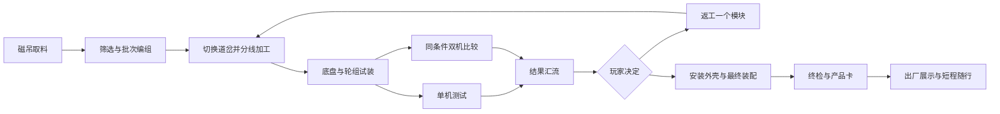

# Video Rebirth · 机械伙伴工厂
日期：2026-10-29。版本：设计评审 v1。
状态：2026-10-29 用户已认可三张图的方向，并通过新 goal 授权开发；运行视觉与玩法仍待实现及验收。
范围：按已确认设计分批开发。未验收候选不替换 4341 稳定版。批准范围与图像哈希见 factory-v1.json。

## 1. 核心体验
玩家从一批原料开始，操作机器、组织生产、装配并测试一台轮式机械伙伴，最后亲眼看着自己的成品驶出工厂。
每道工序都有材料形态或产品行为的变化；实习中的全流程搭建能力，通过分流、汇合、追踪、复核和报告体现。
首轮体验约 8–12 分钟；前 3 分钟完成一次有明显材料变化的加工操作。时间均为待试玩校准的设计目标。
首版采用一种四轮底盘、两种模块配置。产品为玩家膝盖附近高度的机械伙伴，不是人形机器人。
用户已否定以“装着小视频的视频匣”贯穿流程。本方案不恢复该概念，也不把真实视频打分作为通关门槛。

## 2. 玩法闭环
与实习经历的映射保留在设计与可选控制室说明中，不要求玩家理解平台术语才能游玩。
| 平台流程 | 工厂中的可玩对应 |
| --- | --- |
| 评测数据拉取 | 磁吊获取、筛选、失败料件重新提取 |
| 数据集建立 | 托盘编组、批次身份、配置选择 |
| 评测任务包发送 | 生产单、道岔、分线运输 |
| Scoring / Arena | 单机观察记录、同条件双机比较 |
| 结果收集 | 仪器数据与玩家记录汇流，保留试验身份 |
| 结果可视化 | 实体刻度柱、翻牌、前后配置对比 |
| 自动评测报告 | 基于本轮试验生成产品卡，保留返工历史 |

双机比较使用一台明确标注的基准试验机，不强迫玩家先完整制造第二台。
返工保留其他部件，只让被选中的模块返回对应支线；历史测试保留并标记对应配置。
没有倒计时失败、不可逆的材料耗尽或整个批次报废；错误线路可退回，离开工厂可续玩。

## 3. 每站可玩性与状态
| 工位 | 玩家动作 | 可见变化与反馈 | 恢复方式 |
| --- | --- | --- | --- |
| 原料仓与磁吊 | 移动吊头，吸取料块，落入筛选口 | 金属随吊头移动；范围提示贴近吊头；筛后进入不同料仓 | 松开后回收槽接住；不会掉海或遗失 |
| 编组台 | 将材料放入轮廓明确的托盘，选择配置 | 槽位形状与部件一致；托盘保留本批次色标和编号 | 未发车前可随时替换 |
| 分流枢纽 | 转动道岔，启动指定加工机 | 轨道真实改道；护罩闭合后压机冲压；毛坯变成支架 | 无对应材料的机器明确显示缺件；可退回托盘 |
| 试装台 | 操作吊臂靠近装配夹具，扣合轮组与底盘 | 接口高亮，进入合理范围后吸附；部件实际贴合 | 可拆下上一个模块，无隐藏精确角度题 |
| 单机质检 | 选择坡道、颠簸或负载测试，启动并观察 | 机器人实际走完试验段；仪表显示本轮用时、载荷或倾斜 | 卡住自动停止试验并送回起点，记录未完成 |
| 双机试验 | 选择比较项目，同时放行自己与基准机 | 两条相同路线与起跑条件，能观察优缺点 | 可重放；偏好选择不判标准对错 |
| 返工与总装 | 送回一个模块，再装外壳与标识 | 外观配置和测试表现可对应；旧结果不冒充新配置结果 | 保留前配置，允许恢复 |
| 出厂台 | 发起终检，取产品卡，按下放行柄 | 装订机出卡；伙伴驶出舱门并在限定安全范围随行 | 暂停或离开后停靠，不卡住玩家或出口 |

共用输入：沿用现有靠近交互、E 操作、Esc 退出；机器操作期间禁用人物移动，退出后恢复。
移动部件有清晰活动范围、接触提示和安全停机动作；鼠标滑块不是默认操作方式。
HUD 只保留当前主要动作和必要状态；机器自身的指示灯、槽位、仪表承担引导。
取样、搬运和装配应有完整动作链及中断恢复，不能直接瞬移到成品状态。

## 4. 产品与测试规则
- 轮式伙伴：奶油白倒角外壳、四只深色轮胎、可见简化悬挂、青绿色光学传感器、琥珀色尾灯。
- 两种配置暂定为轻快型与稳健型，共用底盘；差异来自可见轮组、配重或货架模块。
- 首版各参数范围需在原型中调校，不把“更重必然更稳”等简化设定当作现实工程结论。
- 单机测试记录实际运行数据；发生卡住、重置或未完成时明确标记，不编造成功成绩。
- 单机测试后，玩家可用实体拨片留下“平稳、摇晃、需要复看”的观察标记；仪器数值自动记录，个人观察不伪装成客观测量。
- 双机比较：同路线、同载荷、同测试条件；隐藏配置身份时同时隐藏性能提示，结束后再揭示。
- 结果汇流区用机械刻度柱、翻牌和可展开产品卡呈现记录；每个结果都能定位到配置与测试轮次。
- 自动报告为本次游戏试验报告，不冒充 Video Rebirth 真实模型评测或公司业务数据。
- 首版短程随行仅限工厂出口展示区；跨岛跟随、召回和复杂导航列为后续可选扩展。

## 5. 场地与路线
尺度草案：厂房约 95 × 65 米，外接约 45 × 30 米测试庭院，中庭高约 16 米；实际用地须先检查主岛现有区域与道路。
布局采用左侧原料/加工翼、中央三层装配中庭、右侧室外测试庭院，返工线沿侧翼回到加工站。
厂房分段顺应海岸，保留植被与岸边缓冲。不能用一块突兀方形地台代替地形融合。
底层：原料仓、编组台、三条加工线、试装/总装台、出厂口；玩家步道与物料路线分开。
中层：宽阔检修回廊、测试观察窗、部件档案；通过楼梯和货梯都可抵达。
上层：调度室、结果汇流厅、海景平台；玩家可以俯瞰批次流向。
测试庭院：两条短而相同的坡道/颠簸/转弯路线，外侧步行旁路与观测位置，远离海边落水线。
任意可到达的平台都必须有返回路线；保留全局“回到营地”，工位卡住可先“退出操作”。
窄角、吊臂下方、货梯门、楼梯转角和摄像机遮挡是首轮灰盒验收点，不能留待美术完成后才检查。

## 6. 探索与重复游玩
- 第一轮由玩家亲自跑通生产链，随后可以接通运输自动化，跳过重复搬运。
- 在回廊观察窗看见自己的批次经过下方机器；运行中的机器提供空间方向感。
- 侧室收藏不同试验配置及失败后的部件，允许观察和复测，不堆积无用途的展牌。
- 屋顶通道、检修廊桥与调度视角作为空间探索奖励；核心工位无需解谜才能找到。
- 配置变化产生第二轮动机，首版不增加多种机器人、经济系统或无限建厂编辑器。

## 7. 美术与原型图
风格：与现有岛屿一致的适度多边形、明确倒角和有克制的材质细节；金属、橡胶、搪瓷、混凝土可区分。
配色：奶油白厂房、暖灰地面、深色钢架、少量青绿色结构件及琥珀工作灯；机械运动和材料变化是视觉主角。
建筑：锯齿采光顶、分段加工翼、通高中庭、室外试验场；夜间步道、接口与楼梯仍需清晰可见。
人物沿用现有白色圆头盔、深蓝服装比例。工厂巨大，但机器和人物操作台之间必须保持合理尺度。
1. [外观与空间总览](factory-01-overview-v1.png)：完整厂区、屋顶局部剖开、三条加工线、汇合与返工路线。
2. [装配中庭与玩家操作](factory-02-assembly-v1.png)：玩家站位、吊臂接触、夹具、部件与成品对照。
3. [测试庭院与夜间可读性](factory-03-testing-v1.png)：同条件双线测试、返工入口、出厂装置，以及夜间辅助视图。
以上为原生生图的设计参考，不是当前运行截图、建模成品或尺寸施工图。机器接口与输送连接以灰盒实测为准。
图像提示词见 [prototype-prompts-v1.md](prototype-prompts-v1.md)；人工图像检查与限制见 [review-v1.md](review-v1.md)。

## 8. 性能与运行约束
- 复用现有 WorldQuality 档位；远处机器停更或低频更新，生产进度由事件驱动，不逐帧轮询 UI。
- 传送带材料按轨道参数移动，重复几何实例化；只对玩家当前拿取/测试的必要部件启用物理。
- 首版最多同时运行两台测试机器人；大量远景流水线使用轻量批次表示，不暗中模拟几十台机器。
- 可见工位才启用细节动画和局部声源；页面隐藏/暂停时停止非必要更新与声音。
- 不新增视频解码、实时镜面捕获或多屏渲染；厂区状态通过静态贴图、灯光和少量几何变化表现。
- 性能验收比较同机同画质下的稳定版与候选版，记录帧耗时、draw calls、三角形、纹理与声源；预算在灰盒测量后定。
- 连续进入/离开三次后检查资源释放；验收时仅开启一个试玩页面，并在当前低资源状态下串行跑重任务。

## 9. 分批开发与交接
当前只交付方案与原型图。用户确认图面后，按以下顺序开展：
1. 灰盒与玩法：一条完整链、配置状态、两台测试机、返工、报告；验证操作有趣且无需说明书。
2. 建模 A 批：伙伴与模块、装配夹具、压机、磁吊、道岔；优先做近距离接触与动作。
3. 建模 B 批：厂房外壳、回廊、输送连接、测试场、地形接驳与夜间照明。
4. 统合：声音、材料、引导、存档、退出恢复、性能及浏览器试玩；验证后再更新 4341。
建议后续会话分工：空间与资产、玩法与测试、动作与接触、性能验收。主会话负责共享接口、整合和交付。
交接 prompt 保持自然：“把这座工厂做成玩家能亲手操作、看懂材料变化的地方。按已确认参考图和本稿负责你的范围，交付可复现的验收证据。”

## 10. 交互原则复核
| 原则 | 本方案落点 |
| --- | --- |
| 意图对齐 | 当前站只突出下一步主要动作 |
| 降低负担 | 首轮一种底盘、两种配置，逐站呈现 |
| 状态可见 | 材料形态、运动、接口灯及测试状态同步 |
| 可恢复 | 退料、模块返工、退出操作、营地兜底 |
| 可操作性 | 手柄/槽位/护罩具有稳定的可用状态 |
| 空间承载信息 | 运输与实物仪表代替长文字任务卡 |
| 无需说明书 | 观察首位试玩者能否独立完成取料和加工 |
| 尊重时间 | 重复搬运可自动化，失败不整批重做 |
| 公平规则 | 比较条件一致，偏好不设唯一答案 |
| 主动作明确 | 各站优先一个交互键，细节检查按需展开 |

## 11. 跨场景约定与验收
沿用 src/components/world/world-i18n.ts 的中英文体系及既有字体、设置与交互组件；上述工位是拟新增模块，不声称已存在。
日夜沿用全局时间系统；局部面板按昼夜保证对比度，不为工厂添加独立主题开关。
验收顺序：主流程状态测试 → 物理/接触与路线 → 浏览器操作 → 昼夜视觉 → 性能；源码通过和用户视觉接受分别记录。
本稿没有改动游戏源代码、公司平台、现有资源或线上部署，也没有启动建模与实现会话。
