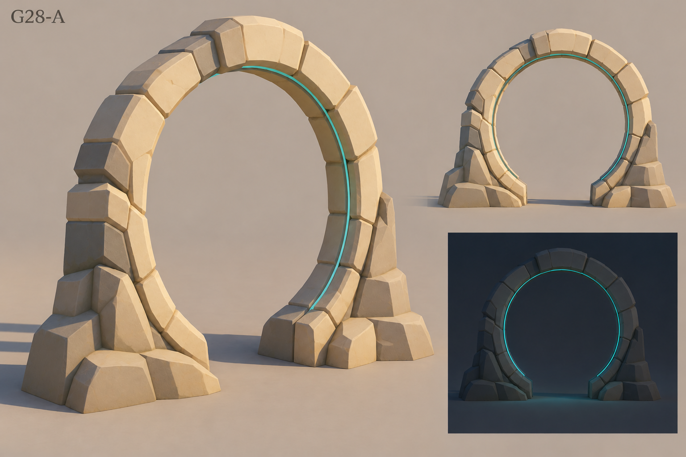
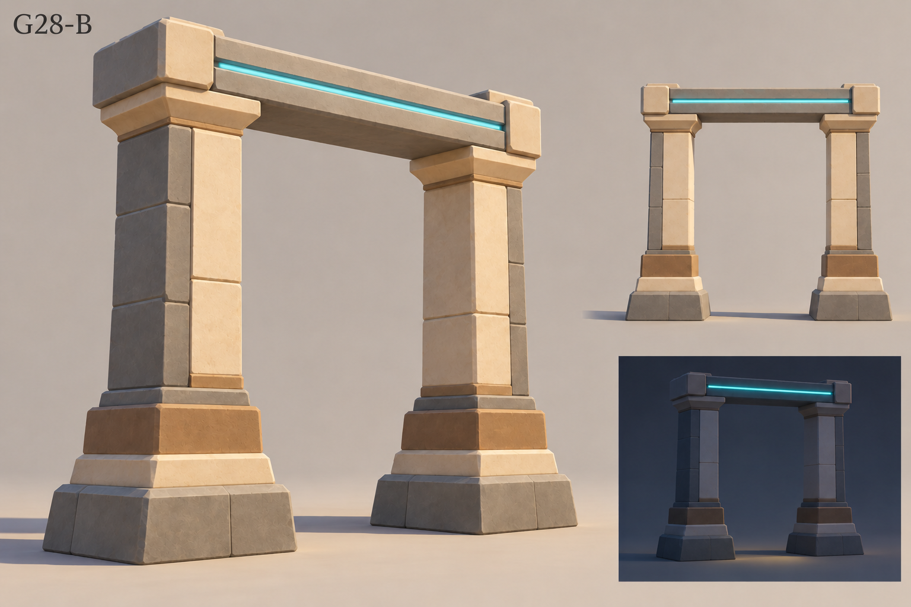
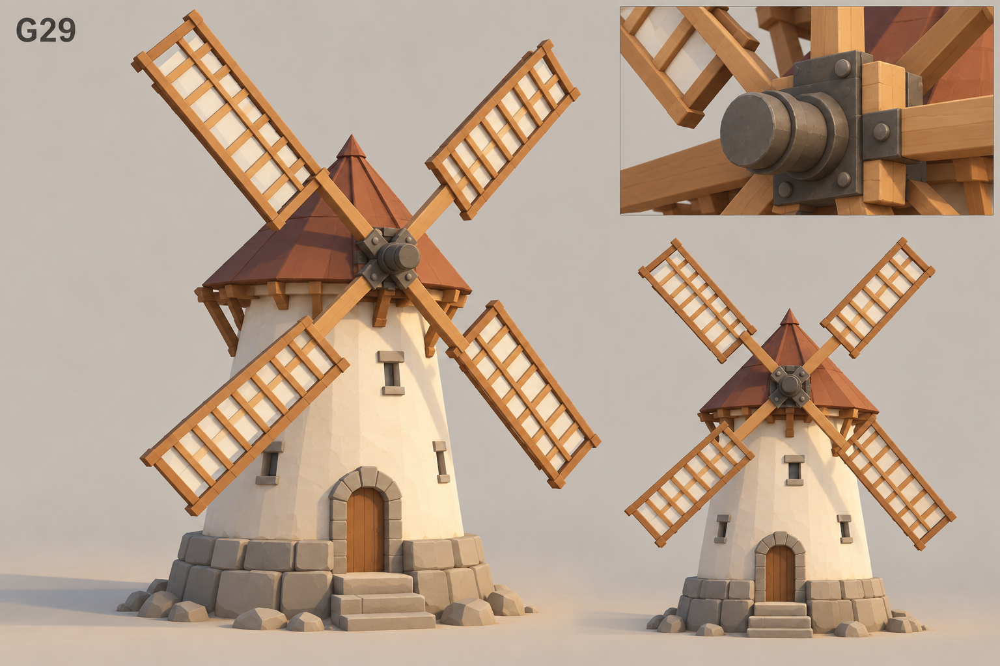
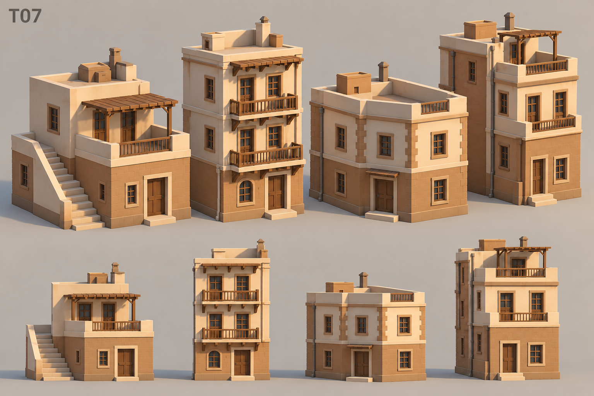

# 原生参考候选 v2

2026-10-21。由 Codex 内置 image_gen 生成并进行一次针对微观纹理的修订，未调用 Hy3D。工具响应未公开具体模型版本。完整原始提示词与修订提示词保存在 [prompts.json](prompts.json)。这些是造型候选，不是 GLB、工程图或已签字资产；不从生成图推断面数、精确尺寸或多视图几何一致性。

| ID | 候选 | 状态 |
| --- | --- | --- |
| G28-A | [石环与内圈细青线](g28-portal-ring-v2.png) | 方向合格；Codex 与 Fable 双方推荐 A，并非 Bobby 亲选 |
| G28-B | [双石柱与横梁顶部细青线](g28-portal-pillars-v2.png) | 方向合格，保留为替换方案，若采用需上移灯线 |
| G29 | [四叶低多风车](g29-windmill-v2.png) | Fable 方向通过，按下述简化要求作为参考 |
| T07 | [两至三层背景楼族](t07-background-buildings-v2.png) | Fable 按删减条件通过，四栋奶白/砖褐，无内容/交互 |

## Fable 设计审阅（2026-10-21）

Fable 已在 WorkBuddy `00-website-main` 收到职责/预算同步，并维护 PRD v1.3、制作管线及相关冻结口径。审阅源为 `bobby-3d-world/审阅-codex-native-v2.md`；这里记录设计结论，不意味着 Bobby 批准建模。

- G28：两案均合格，Fable 推荐 A，理由是俯视剪影更独特。A 建模时主石建议 10–14 块、左右底座各 3 块以内、青线宽不超过环截面 1/5；若后续改用 B，青线需移至横梁上沿以便俯视可见。按 Fable 2026-10-21 协作提案，Codex 与 Fable 双方推荐 A 进清单作参考，并非 Bobby 亲选；Bobby 可随时提出改用 B，不以二选一阻塞。
- G29：方向通过，四叶需为独立可转节点；每叶格栅简化到 2–3 根横档，远景塔身门窗可省，面数按 skill 逐件声明。
- T07：按删减条件通过，删外梯、屋顶藤架、拱门与密集阳台栏杆，保留平顶/女儿墙、规则窗格及克制屋顶构件。图中上下两排是同四栋的两个视图，不是八个独立资产；第一栋仍有外梯，不能直接当无外梯样本。数量/视图事实已回传 Fable 更正，不影响其删减要求。场景仍只放 3–4 栋背景楼。

## Astra 两轮视觉差异记录

v1 主要问题：石材孔洞/裂纹/苔藓偏写实；风车木纹、瓦片、铆钉和草丝细碎；背景楼藤蔓、陈设和石砌纹理容易抢主楼。v2 只针对这些问题收敛，没有改变资产类别或扩大轻科技位置。

- G28-A：苔藓、孔洞、碎裂纹已基本去除，大块石面更接近风格锁。内圈细青线符合原候选契约；首轮误提的“仅顶部”限制已撤回，顶部限制只属于 G28-B。
- G28-B：双柱表面更干净，顶部青线正确。日景灯带仍较亮，后续不应增强泛光；不进一步放大柱脚细纹。
- G29：风车轮廓明确，屋顶、石基、木件已简化。轮毂保留主要连接结构即可；图像不能证明叶片间隙和旋转装配正确。
- T07：四栋楼层和奶白/砖褐保持，藤蔓陈设已移除。仍需控制栏杆、窗格、砖缝的密度，无交互由实现保证。

这轮视觉审阅不替代 Bobby 签字。资产预算与后续造型/材质/连接/导出验收使用四项已注册 skills 的适用规则；不得照搬其他项目的果实预算，也不能仅靠加面提升指标。G28/G29/T07 建模仍等灰盒门通过；另行授权的16件营地样片例外不包含这三项。

